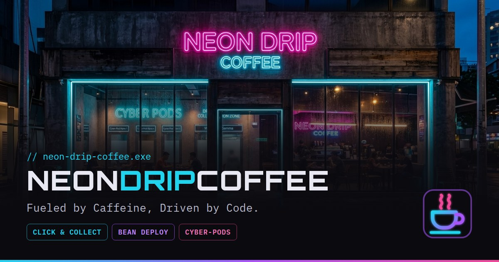

# Neon Drip Coffee ☕⚡

> _Fueled by Caffeine, Driven by Code._



Aplicación web full-stack para una cafetería de especialidad **ficticia** con estética cyberpunk en Montevideo. Es un proyecto personal de portfolio, pensado para practicar cómo se construye un producto real de punta a punta: catálogo, pagos, suscripciones, reservas y cuentas de usuario.

🔗 **Demo:** _próximamente_

---

## ¿Qué se puede hacer?

| Flujo | Descripción |
| --- | --- |
| **Click & Collect** | Pedir café y repostería desde el menú, pagar online y retirar en barra. |
| **Bean Deploy** | Suscribirse a envíos periódicos de café de especialidad (semanal, quincenal o mensual), con buscador de direcciones y mapa. |
| **Cyber-Pods** | Reservar espacios de coworking por hora: elegir pod, fecha, duración y horario disponible. Precio con descuento automático en reservas largas. |
| **Mi cuenta** | Registro, inicio de sesión, recuperación de contraseña e historial de pedidos, suscripciones y reservas. |

## Stack

- **Framework:** [Next.js 16](https://nextjs.org/) (App Router, Server Components, Server Actions) + React 19
- **Lenguaje:** TypeScript
- **Estilos:** Tailwind CSS v4 con design tokens propios
- **Base de datos:** PostgreSQL en [Supabase](https://supabase.com/) + [Prisma ORM](https://www.prisma.io/)
- **Autenticación:** [Auth.js](https://authjs.dev/) (NextAuth v5) con credenciales y contraseñas hasheadas con bcrypt
- **Pagos:** [Stripe](https://stripe.com/) Checkout (pagos únicos y suscripciones) + webhooks
- **Emails:** [Resend](https://resend.com/) (recuperación de contraseña)
- **Mapas:** [Mapbox](https://www.mapbox.com/) (búsqueda de direcciones y mapa estático)
- **Estado del cliente:** Zustand (carrito)
- **Validación:** Zod

## Decisiones técnicas destacadas

- **El precio se calcula siempre en el servidor.** El cliente muestra una estimación, pero el monto que se cobra lo recalcula el servidor con los datos de la base, usando la misma función pura (`src/lib/coworking-pricing.ts`).
- **Sin reservas duplicadas.** La verificación de horario disponible y la creación de la reserva ocurren dentro de una misma transacción de base de datos.
- **Pagos confirmados por webhook.** Pedidos, reservas y suscripciones quedan en estado `PENDING` hasta que Stripe confirma el pago mediante un webhook con firma verificada.
- **Un solo checkout para todo.** El carrito puede combinar productos y una suscripción en la misma sesión de pago de Stripe.
- **Seed idempotente.** `prisma/seed.ts` usa `upsert`, así puede ejecutarse varias veces sin duplicar datos ni romper reservas o suscripciones existentes.
- **Rutas protegidas.** `src/proxy.ts` usa una configuración liviana de Auth.js (sin Prisma) para proteger `/account` y `/admin` antes de renderizar la página.
- **SEO y accesibilidad.** Metadata por página, `sitemap.xml`, `robots.txt`, datos estructurados (schema.org `CafeOrCoffeeShop` y `FAQPage`), `llms.txt` y formularios accesibles.

## Estructura

```
src/
├── actions/       # Server Actions (pedidos, reservas, suscripciones, auth)
├── app/           # Rutas (App Router), API routes y webhook de Stripe
├── components/    # Componentes por dominio (menu, coworking, bean-deploy, cart…)
├── lib/           # Prisma, Stripe, Auth.js, validaciones Zod y utilidades
├── store/         # Carrito (Zustand)
└── types/
prisma/
├── schema.prisma  # Modelo de datos (12 modelos)
└── seed.ts        # Datos de ejemplo
```

## Cómo correrlo localmente

**Requisitos:** Git, Node.js 20+ y cuentas gratuitas en Supabase, Stripe, Resend y Mapbox.

```bash
# 1. Clonar el repositorio y entrar a la carpeta
git clone https://github.com/martinmaccmacc-hash/neon-drip-coffee.git
cd neon-drip-coffee

# 2. Instalar dependencias
npm install

# 3. Configurar variables de entorno
cp .env.example .env   # y completar los valores

# 4. Crear las tablas y cargar datos de ejemplo
npx prisma migrate dev
npx prisma db seed

# 5. Levantar el servidor de desarrollo
npm run dev
```

La app queda disponible en [http://localhost:3000](http://localhost:3000).

Para probar los pagos en local, reenviá los webhooks con la [CLI de Stripe](https://docs.stripe.com/stripe-cli):

```bash
stripe listen --forward-to localhost:3000/api/webhooks/stripe
```

Y usá la tarjeta de prueba `4242 4242 4242 4242`, con cualquier fecha futura y cualquier CVC.

> **Nota:** los emails se envían con el remitente de pruebas de Resend, que solo entrega a la cuenta con la que te registraste en Resend.

## Desarrollo asistido por IA 🤖

Quiero ser transparente: **este proyecto lo desarrollé con la ayuda de inteligencia artificial** (Claude, de Anthropic) como herramienta de aprendizaje y de pair programming.

Estoy estudiando desarrollo full-stack y todavía no tengo experiencia profesional. La IA me ayudó a escribir y revisar código, a entender conceptos nuevos y a resolver errores. Yo me encargué de:

- Definir el concepto, la identidad de marca y las funcionalidades del negocio.
- Tomar las decisiones de producto y de diseño (precios, flujos, estructura de las páginas).
- Generar las imágenes del sitio.
- Configurar los servicios (Supabase, Stripe, Resend, Mapbox), correr las migraciones y probar cada flujo.
- Revisar, integrar y versionar los cambios.

Para mí, el valor de este proyecto está en lo que aprendí construyéndolo: cómo se conectan las piezas de una aplicación real, por qué se toman ciertas decisiones (validar en el servidor, usar transacciones, confirmar pagos por webhook) y cómo trabajar con herramientas de IA de forma crítica y responsable.

## Próximos pasos

- [ ] Publicar la demo en Vercel
- [ ] Panel de administración para gestionar productos, pedidos y reservas
- [ ] Cancelación de reservas desde la web
- [ ] Tests automatizados (unitarios y end-to-end)

## Autor

**Martin Castillo** — estudiante de desarrollo full-stack.

- GitHub: [@martinmaccmacc-hash](https://github.com/martinmaccmacc-hash)
<!-- Agregá tu LinkedIn -->

---

_Neon Drip Coffee es un negocio ficticio creado con fines educativos. Las imágenes del local y los productos fueron generadas con IA._
