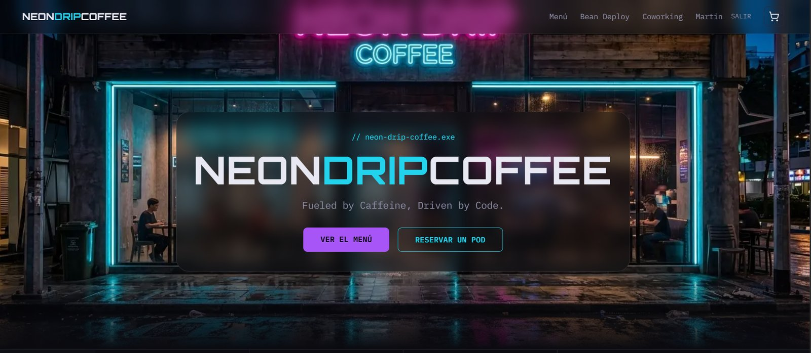
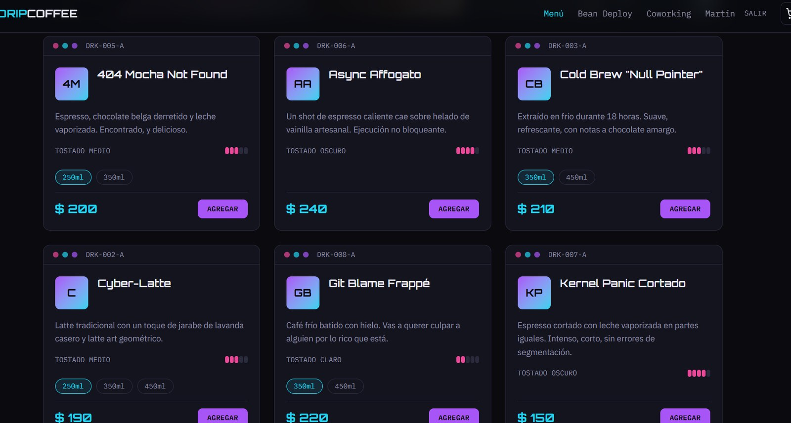
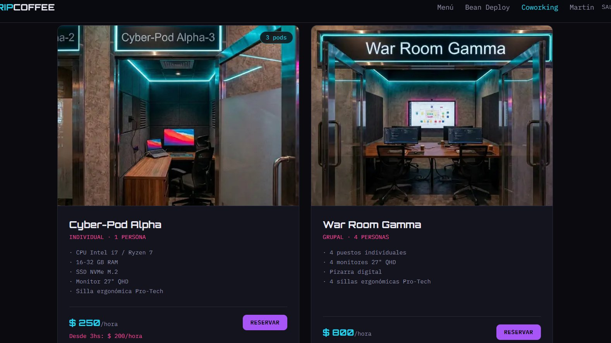

# Neon Drip Coffee ☕⚡

> _Fueled by Caffeine, Driven by Code._


Aplicación web full-stack para una cafetería de especialidad **ficticia** con estética cyberpunk en Montevideo. Es un proyecto personal de portfolio, pensado para practicar cómo se construye un producto real de punta a punta: catálogo, pagos, suscripciones, reservas y cuentas de usuario.

🔗 **Demo:** [neon-drip-coffee.vercel.app](https://neon-drip-coffee.vercel.app)

> Los pagos funcionan en **modo de prueba** de Stripe: podés comprar o reservar con la tarjeta `4242 4242 4242 4242`, cualquier fecha futura y cualquier CVC. No se cobra dinero real.

---

## ¿Qué se puede hacer?

| Flujo | Descripción |
| --- | --- |
| **Click & Collect** | Pedir café y repostería desde el menú, pagar online y retirar en barra. |
| **Bean Deploy** | Suscribirse a envíos periódicos de café de especialidad (semanal, quincenal o mensual), con buscador de direcciones y mapa. |
| **Cyber-Pods** | Reservar espacios de coworking por hora: elegir pod, fecha, duración y horario disponible. Precio con descuento automático en reservas largas. |
| **Mi cuenta** | Registro, inicio de sesión, recuperación de contraseña e historial de pedidos, suscripciones y reservas. |

## Capturas

**Home**



**Menú (Click & Collect)**: variantes de tamaño, nivel de tostado y carrito.



**Cyber-Pods**: pods agrupados por modelo, ficha técnica y precio con descuento.



## Stack

- **Framework:** [Next.js 16](https://nextjs.org/) (App Router, Server Components, Server Actions) + React 19
- **Lenguaje:** TypeScript
- **Estilos:** Tailwind CSS v4 con design tokens propios
- **Base de datos:** PostgreSQL en [Supabase](https://supabase.com/) + [Prisma ORM](https://www.prisma.io/)
- **Autenticación:** [Auth.js](https://authjs.dev/) (NextAuth v5) con credenciales y contraseñas hasheadas con bcrypt
- **Pagos:** [Stripe](https://stripe.com/) Checkout (pagos únicos y suscripciones) + webhooks
- **Emails:** [Resend](https://resend.com/) (recuperación de contraseña)
- **Mapas:** [Mapbox](https://www.mapbox.com/) (búsqueda de direcciones y mapa estático)
- **Estado del cliente:** Zustand (carrito)
- **Validación:** Zod

## Decisiones técnicas destacadas

- **El precio se calcula siempre en el servidor.** El cliente muestra una estimación, pero el monto que se cobra lo recalcula el servidor con los datos de la base, usando la misma función pura (`src/lib/coworking-pricing.ts`).
- **Sin reservas duplicadas.** La verificación de horario disponible y la creación de la reserva ocurren dentro de una misma transacción de base de datos.
- **Pagos confirmados por webhook.** Pedidos, reservas y suscripciones quedan en estado `PENDING` hasta que Stripe confirma el pago mediante un webhook con firma verificada.
- **Un solo checkout para todo.** El carrito puede combinar productos y una suscripción en la misma sesión de pago de Stripe.
- **Seed idempotente.** `prisma/seed.ts` usa `upsert`, así puede ejecutarse varias veces sin duplicar datos ni romper reservas o suscripciones existentes.
- **Rutas protegidas.** `src/proxy.ts` usa una configuración liviana de Auth.js (sin Prisma) para proteger `/account` y `/admin` antes de renderizar la página.
- **SEO y accesibilidad.** Metadata por página, `sitemap.xml`, `robots.txt`, datos estructurados (schema.org `CafeOrCoffeeShop` y `FAQPage`), `llms.txt` y formularios accesibles.

## Estructura

```
src/
├── actions/       # Server Actions (pedidos, reservas, suscripciones, auth)
├── app/           # Rutas (App Router), API routes y webhook de Stripe
├── components/    # Componentes por dominio (menu, coworking, bean-deploy, cart…)
├── lib/           # Prisma, Stripe, Auth.js, validaciones Zod y utilidades
├── store/         # Carrito (Zustand)
└── types/
prisma/
├── schema.prisma  # Modelo de datos (12 modelos)
└── seed.ts        # Datos de ejemplo
```

## Cómo correrlo localmente

### 1. Instalar las herramientas

Necesitás **Git** (para descargar el código) y **Node.js** (para ejecutarlo; trae incluido `npm`). Si ya los tenés, saltá a la verificación.

**Windows**

1. Descargá e instalá **Git** desde [git-scm.com/download/win](https://git-scm.com/download/win). Las opciones por defecto del instalador están bien.
2. Descargá e instalá **Node.js** en su versión **LTS** desde [nodejs.org](https://nodejs.org/). Instala también `npm`.
3. Cerrá y volvé a abrir la terminal (PowerShell o la de VS Code) para que reconozca los programas nuevos.

**macOS**

```bash
xcode-select --install   # instala Git
```

Y Node.js LTS desde [nodejs.org](https://nodejs.org/), o con Homebrew: `brew install node`.

**Linux (Ubuntu/Debian)**

```bash
sudo apt update && sudo apt install git
```

Para Node.js se recomienda [nvm](https://github.com/nvm-sh/nvm): después de instalarlo, `nvm install --lts`.

**Verificación:** estos comandos tienen que mostrar un número de versión.

```bash
git --version
node -v    # 20.9 o superior
npm -v
```

> **Windows: si `npm` muestra un error de "ejecución de scripts deshabilitada"**, abrí PowerShell y ejecutá esto una vez:
>
> ```powershell
> Set-ExecutionPolicy -Scope CurrentUser RemoteSigned
> ```

Como editor se recomienda [Visual Studio Code](https://code.visualstudio.com/) (opcional).

### 2. Crear las cuentas y obtener las claves

El proyecto usa servicios externos con plan gratuito. Cada uno da una clave que va en el archivo `.env`:

| Servicio | Para qué se usa | Variables en `.env` | Dónde se obtiene |
| --- | --- | --- | --- |
| [Supabase](https://supabase.com/) | Base de datos PostgreSQL | `DATABASE_URL`, `DIRECT_URL` | Proyecto → botón **Connect** → cadenas de conexión (pooler y directa) |
| [Stripe](https://stripe.com/) | Pagos (modo test) | `STRIPE_SECRET_KEY`, `STRIPE_WEBHOOK_SECRET` | Dashboard → **Developers → API keys**. El webhook secret lo muestra `stripe listen` (ver paso 4) |
| [Resend](https://resend.com/) | Emails de recuperación de contraseña | `RESEND_API_KEY` | Dashboard → **API Keys** |
| [Mapbox](https://www.mapbox.com/) | Buscador de direcciones y mapa | `NEXT_PUBLIC_MAPBOX_TOKEN` | Cuenta → **Access tokens** (el token público por defecto) |

Además, `AUTH_SECRET` se genera con `npx auth secret` (después del paso 3), y `NEXT_PUBLIC_APP_URL` queda como `http://localhost:3000` para trabajar en local.

### 3. Clonar, instalar y ejecutar

```bash
# 1. Clonar el repositorio y entrar a la carpeta
git clone https://github.com/martinmaccmacc-hash/neon-drip-coffee.git
cd neon-drip-coffee

# 2. Instalar dependencias
npm install

# 3. Crear el archivo de variables de entorno y completarlo con las claves del paso 2
cp .env.example .env   # en CMD de Windows: copy .env.example .env

# 4. Crear las tablas y cargar datos de ejemplo
npx prisma migrate dev
npx prisma db seed

# 5. Levantar el servidor de desarrollo
npm run dev
```

La app queda disponible en [http://localhost:3000](http://localhost:3000).

### 4. (Opcional) Probar los pagos

Instalá la [CLI de Stripe](https://docs.stripe.com/stripe-cli), iniciá sesión con `stripe login` y, con la app corriendo, reenviá los webhooks a tu entorno local:

```bash
stripe listen --forward-to localhost:3000/api/webhooks/stripe
```

El comando muestra un secreto que empieza con `whsec_`: copialo en `STRIPE_WEBHOOK_SECRET` dentro de `.env` y reiniciá `npm run dev`. Para pagar, usá la tarjeta de prueba `4242 4242 4242 4242`, con cualquier fecha futura y cualquier CVC.

### Notas

- **Supabase puede pausar la base de datos.** En el plan gratuito, Supabase pausa los proyectos tras unos días sin actividad. Si la app o `npm run build` muestran `Can't reach database server`, entrá al [dashboard de Supabase](https://supabase.com/dashboard), reanudá el proyecto (_Restore project_) y esperá un par de minutos. El build también necesita la base, porque genera de antemano las páginas de Menú, Bean Deploy y Coworking. El repositorio incluye un workflow de GitHub Actions (`.github/workflows/keep-supabase-alive.yml`) que consulta la base dos veces por semana para reducir las pausas, aunque no las evita en todos los casos.
- **Emails de prueba.** Los emails se envían con el remitente de pruebas de Resend, que solo entrega a la cuenta con la que te registraste en Resend.

## Desarrollo asistido por IA 🤖

Quiero ser transparente: **este proyecto lo desarrollé con la ayuda de inteligencia artificial** (Claude, de Anthropic) como herramienta de aprendizaje y de pair programming.

Estoy estudiando desarrollo full-stack y todavía no tengo experiencia profesional. La IA me ayudó a escribir y revisar código, a entender conceptos nuevos y a resolver errores. Yo me encargué de:

- Definir el concepto, la identidad de marca y las funcionalidades del negocio.
- Tomar las decisiones de producto y de diseño (precios, flujos, estructura de las páginas).
- Generar las imágenes del sitio.
- Configurar los servicios (Supabase, Stripe, Resend, Mapbox), correr las migraciones y probar cada flujo.
- Revisar, integrar y versionar los cambios.

Para mí, el valor de este proyecto está en lo que aprendí construyéndolo: cómo se conectan las piezas de una aplicación real, por qué se toman ciertas decisiones (validar en el servidor, usar transacciones, confirmar pagos por webhook) y cómo trabajar con herramientas de IA de forma crítica y responsable.

## Próximos pasos

- [x] Publicar la demo en Vercel
- [ ] Panel de administración para gestionar productos, pedidos y reservas
- [ ] Cancelación de reservas desde la web
- [ ] Tests automatizados (unitarios y end-to-end)

## Autor

**Martin Castillo** — estudiante de desarrollo full-stack.

- GitHub: [@martinmaccmacc-hash](https://github.com/martinmaccmacc-hash)
- Linkedin: www.linkedin.com/in/martin-castillo-dev1996

---

_Neon Drip Coffee es un negocio ficticio creado con fines educativos. Las imágenes del local y los productos fueron generadas con IA._
